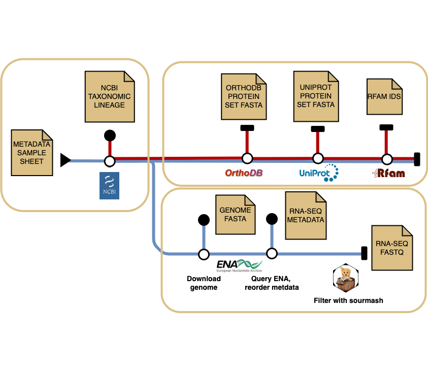

# Introduction

**ebi-metagenomics/datascout** is a pipeline to query and fetch protein, RNA and transcriptomic evidence to support eukaryotic gene annotation, from different data archives: European Nucleotide Archive (ENA), Rfam, UniProt and OrthoDB

The pipeline allows for bespoke requests such as specificity of taxonomic rank queried, evidence levels and volume of outputs.


> [!NOTE]
> This pipeline uses the [nf-core](https://nf-co.re) template with some tweaks, but it's not part of nf-core.

# Pipeline steps

The datascout pipeline is split into the following steps:

<p align="center">
    
</p>

## Step 1. Construct taxonomic lineage

Uses NCBI taxdump to construct taxonomic lineages using [ete toolkit](https://github.com/etetoolkit/ete), ignoring any ranks labelled as "no rank".

## Step 2. OrthoDB

Collects orthologous protein sequences from [OrthoDB](https://www.orthodb.org) for each genome. The cluster ids
come from the OrthoDB API, but the sequences themselves are read from a
[local OrthoDB database](#building-the-orthodb-database), which is much faster than downloading
clusters one by one from the API. The step runs in four parts:

1. **Query the OrthoDB API** (once per input genome). The pipeline goes through the
   genome's taxonomic lineage from Step 1, starting with the most specific rank. At each rank it
   searches OrthoDB API for orthologous groups at that taxid, with the following filters:
   - `universal: 0.9`: the group has to be present in at least 90% of the species under that taxon
   - `singlecopy: 0.9`: the group has to be single-copy in at least 90% of those species

   The search stops at the first rank that returns any groups. If the samplesheet sets an
   `orthodb` rank, the search stops there instead, even when nothing has been found. Genomes that
   match no rank are listed in `no_orthodb_taxon.csv` and get no OrthoDB output. The resolved taxid is written to `<sample_id>_taxon.txt`, and its clusters (orthologous group ids with their gene counts) to `<sample_id>_clusters.tsv`. `--max_orthodb_clusters` limits how many clusters are kept, which is mostly useful for testing.

3. **Fetch the protein sequences for each taxon** (once per unique taxon).
   The cluster ids are looked up in the [local OrthoDB database](#building-the-orthodb-database), which links each cluster to its protein sequences. All the matching proteins are collected into `combined_orthodb_<taxid>.faa`.

   With `--orthodb_min_proteins` set, the pipeline first counts the taxon's proteins and drops the
   taxon if it has fewer than the threshold. The count is per taxon, so every genome that resolved
   to that taxon is dropped and listed in `low_protein_genomes.csv`. This matters for downstream
   pipelines that can't handle genomes with too little gene evidence, such as the MGnify Genomes
   Catalogue Pipeline. BRAKER, for example, runs AUGUSTUS, which crashes when the protein evidence
   is too small to train its prediction model
   ([details in this issue](https://github.com/Gaius-Augustus/BRAKER/issues/8)).

### Keeping the local database and the API on the same OrthoDB release

The cluster ids from the API and the local database have to come from the
same OrthoDB release, for example `v12.2`.

**Why.** OrthoDB versions its releases as `<major>.<minor>`, but only the major version is part of
the API URL (`https://data.orthodb.org/v12/`). That URL always serves the newest minor release of
v12, and the [data dump](https://data.orthodb.org/v12/download/odb_data_dump/) used to build the
local database exists only for that release: once `v12.2` is out, the `v12.1` dump is gone.
Orthologous group ids are not stable between releases either. The same id can be reused for a group
with different members, and some ids disappear. If the database is from a different release than the
API, the cluster ids still look valid, but their lookup can quietly return the wrong proteins or
none at all, and nothing fails.

**How.** Before any cluster is queried, pipeline checks which release OrthoDB currently
serves (`https://data.orthodb.org/<major>/orthodb_release_id`). If it matches
`--orthodb_version`, the database at `<orthodb_db_dir>/<orthodb_version>/orthodb.duckdb` is reused;
otherwise a new database is built from the served release, with a warning, and that release is
passed downstream so the API queries and the database stay on the same release.

See [Building the OrthoDB database](#building-the-orthodb-database) for where databases are kept and
how to build one ahead of a run.

## Step 3. UniProt

Query UniProt for proteins matching the most specific possible taxid OR the given rank in the samplesheet.
Created a protein fasta file with simplifed headers.

Uses user provides filters:
Evidence level 1 = Experimental evidence at protein level
Evidence level 2 = Experimental evidence at transcript level OR above
Evidence level 3 = Protein inferred from homology OR above

Results are filtered for swissprot only entries if the the input flag is used.

## Step 4 (optional). Rfam

Query Rfam for models matching the most specific possible taxid OR the given rank in the samplesheet.
Outputs a list of Rfams.

This step uses the [credentials](assets/rfam_db.conf) for the public Rfam database

This step can be disabled with `--skip_rfam`, in which case no Rfam query is performed and no `rfam_dir` output is produced.

## Step 5. ENA and transcriptomes

This step groups values in samplesheet data by genome_id and ena_tax to avoid download duplicate sets of reads for the same genome.
Per grouping it queries ENA for transcriptomic reads matching the most specific possible taxid OR the given rank (ena_tax) in the samplesheet.

The results are reordered with the following critera to try and download the most diverse set of reads possible (i.e. not all reads from the same sample/study):
- Check data is paired and with two files
- filter short sequences read length <75
- sort by descending base count
- group by sample name and cycle through alternating the names

Downloads fastq files for the used specified number of max runs and uncompresses the files

## Step 6 (optional). Sourmash subworkflow

Check containment of the downloaded reads in the genome (both sketches).
Filter only runs which contribute >= 1% unique kmers mapped to the genome in the output.

# Usage

Typical pipeline commands:
<!-- TODO: check this commands -->
```
#   run datascout reusing orthodb_db/v12.2/orthodb.duckdb as-is if the version v12.2 is still served by OrthoDB API, otherwise build newer version
nexflow run main.nf --outdir results/ --samplesheet input.csv --orthodb_db_dir orthodb_db/ --orthodb_version v12.2

#   run datascout and build the v12.2 of the OrthoDB database to use
nexflow run main.nf --outdir results/ --samplesheet input.csv --orthodb_db_dir orthodb_db/ --orthodb_version v12.2 --download_rna_fastq false --skip_rfam

#   run datascout, build the v12.2 of the OrthoDB database, skip Rfam calling and download of transcriptomic read runs
nexflow run main.nf --outdir results/ --samplesheet input.csv --orthodb_db_dir orthodb_db/ --orthodb_version v12.2 --download_rna_fastq false --skip_rfam
```

Pipeline help:

```angular2html
USAGE:
  nextflow run main.nf --samplesheet <file> [options]

REQUIRED INPUT/OUTPUT OPTIONS:
  --samplesheet <file>    Path to comma-separated file (CSV/TSV/YAML) containing
                          information about the samples and genomes.
                          You will need to create this before running the pipeline.

OPTIONAL INPUT/OUTPUT OPTIONS:
  --outdir <dir>          The output directory where the results will be saved.
                          [default: results]

DATABASE OPTIONS:
  --taxdump <file>        Path to NCBI taxonomy dump file. Will be downloaded if not provided.
                          Used for taxonomic lineage parsing.
  --sqlite <dir>          Path to NCBI sqlite database. Will be downloaded if not provided.
                          Used for taxonomic lineage parsing.
                          <!-- TODO: make sure this is updated -->
  --orthodb_db_dir <dir>  Path where the database this run needs is looked for, at exactly
                          <orthodb_db_dir>/<orthodb_version>/orthodb.duckdb, and reused as-is
                          when it already holds the release OrthoDB currently serves. Unset by
                          default, so every run builds its own OrthoDB database.
  --orthodb_version <str> OrthoDB release of the input OrthoDB or OrthoDB to generate, for example v12.2.
                          [default: v12.2]
  --orthodb_og2genes <file>, --orthodb_og_aa_fasta <file>
                          Dump files already on disk. Given together, ORTHODB_GETDB builds from
                          them instead of downloading them from
                          https://data.orthodb.org/v12/download/odb_data_dump/. Left unset,
                          building a database downloads both files fresh, about 39 GB, which
                          can take a while.
  --rfam_db <file>        Path to the latest available public Rfam database connection config.
                          [default: ${projectDir}/assets/rfam_db.txt]
                          Used for RNA family searches.

PROCESSING OPTIONS:
  --max_runs <int>        Maximum number of runs to process.
                          [default: 100, min: 1, max: 10000]
  --download_rna_fastq    Enable transcriptomic FASTQ download and publishing.
                          Used only when --sourmash is false. Ignored when
                          --sourmash is true. [default: true]
  --max_orthodb_clusters <int> Maximum number of clusters to download from orthodb.
                          [default: 0 (as many as available)]
  --order_runs_by_smallest <boolean> Select smallest transcriptome fastq files first
                          [default: false (largest to smallest)]
  --sourmash              Enable sourmash filtering.
                          Uses sourmash for sequence similarity filtering instead of
                          direct FASTQ download. [default: false]
  --swissprot             Use SwissProt database only.
                          Restricts UniProt searches to manually curated entries. [default: false]
  --orthodb_min_proteins <int> Minimum number of OrthoDB proteins required to keep a
                          genome, counted per resolved taxon. Genomes whose taxon is below
                          the threshold produce no orthodb_dir and are listed in
                          low_protein_genomes.csv. [default: 0 (filter disabled)]
  --skip_rfam             Skip the Rfam accessions retrieval step.
                          When enabled, the pipeline will not query Rfam and no
                          rfam_dir output is produced. [default: false]
```

# Building the OrthoDB database

The pipeline requires DuckDB SQL database generated out of two files of the
[OrthoDB data dump](https://data.orthodb.org/v12/download/odb_data_dump/), `odb*_OG2genes.tab.gz`,
which maps orthologous groups to gene ids, and `odb*_og_aa_fasta.gz`, which holds the protein
sequences. This DuckDB database is generated by ORTHODB_GETDB module.

The database holds three tables: `og2genes` maps orthologous groups to gene ids, `proteins` holds
one sequence per gene id, and `meta` records the OrthoDB release it was built from, `v12.2`.

If `--orthodb_db_dir` and `--orthodb_version` are provided, pipeline run checks for a candidate database at exactly `<orthodb_db_dir>/<orthodb_version>/orthodb.duckdb`. When the file there already holds the release OrthoDB currently serves, it's reused as-is; otherwise (that release has moved on, or nothing is there yet) a fresh database is
built during the pipeline run and used to collect protein evidence. The database is also build when `--orthodb_db_dir` is not set. Building one downloads both
dump files fresh unless `--orthodb_og2genes`/`--orthodb_og_aa_fasta` are given, about 39 GB, so a
run that needs to build can take a while.

A freshly built database by default is copied to the output folder by default. It is also recommended to set
ORTHODB_GETDB's `publishDir` to `params.orthodb_db_dir` to make sure all versions of OrthoDB are stored in one place and ready for reuse:

```
process {
      withName: ORTHODB_GETDB {
        publishDir = [
            path: params.orthodb_db_dir,
            mode: 'copy',
            pattern: "*/orthodb.duckdb"
        ]
    }
}
```

To build or validate the database yourself, rather than inside a pipeline run:

```bash
#   reuse orthodb_db/v12.2/orthodb.duckdb as-is if the version v12.2 is still served by OrthoDB API, otherwise build newer version
python3 bin/orthodb_getdb.py --release v12.2 --db_dir orthodb_db --input orthodb_db/v12.2/orthodb.duckdb

#   download both dump files and build the database fresh, about 39 GB of downloads
python3 bin/orthodb_getdb.py --release v12.2 --db_dir orthodb_db --download_dir /path/to/dump

#   or build from files already on disk
python3 bin/orthodb_getdb.py --release v12.2 --db_dir orthodb_db \
    --og2genes /path/to/odb12v2_OG2genes.tab.gz \
    --og_aa_fasta /path/to/odb12v2_og_aa_fasta.gz
```

# Samplesheet

The samplesheet is a comma separated file with the following columns. Please include a blank field for the optional columns even if they are unused.
You can use the [example samplesheet](assets/samplesheet.csv) to guide you.

Required columns

| Column      | Type    | Description                                                                  |
| ----------- | ------- | ---------------------------------------------------------------------------- |
| `sample_id` | string  | Unique identifier for the sample. Each sample must have a distinct ID.       |
| `genome`    | string  | Genome assembly accession (e.g. `GCA_003719455.1`) for the submitted genome. |
| `taxid`     | integer | NCBI taxonomy ID corresponding to the genome.                                |

Optional columns

| Column             | Type    | Default   | Description                                                              |
| ------------------ | ------- | --------- | ------------------------------------------------------------------------ |
| `orthodb`          | string  | `default` | Maximum taxonomic level to use for OrthoDB queries.                      |
| `uniprot`          | string  | `default` | Preferred taxonomic level for UniProt queries.                           |
| `rfam`             | string  | `default` | Preferred taxonomic level for RFAM RNA family searches.                  |
| `ena`              | string  | `default` | Preferred taxonomic level for ENA transcriptome data.                    |
| `uniprot_evidence` | integer | `2`       | Minimum UniProt evidence level (higher = more reliable, but fewer hits). |
| `assembly_file`    | string  | —         | Path to an existing genome FASTA file (skips download if provided).      |

# Outputs

The outputs of the pipeline are as follows:

File ending **tax_ranks.tsv** per sample: Taxonomic lineage and corresponding taxids and ranks of the input taxid.

File ending **reheaded_assembly.fasta**: Reformatted genome fasta file

File ending **ENA_filtered_rna.csv**: One per unique genome ID. A list of matching transcriptomic reads in ENA and their metadata

Folder ending **rna_fastq_dir**: Named as per the preferred max rank level provided in input (or "default")
  - Contains unzipped fastq transcriptomic files

Folder ending **orthodb_dir**: One per sample, and contains protein fasta files from orthoDB

  - Subfolders per orthodb cluster

Folder ending **rfam_dir**: One per sample, and contains rfam data

  - Contains file **rfam_ids.txt** with a list of matching Rfam IDs

Folder ending **uniprot_dir**: One per sample, and contains protein fasta files from UniProt

  - Contains raw and reformatted protein fasta files named by taxid

File **low_protein_genomes.csv**: Only written when `--orthodb_min_proteins` drops at least one sample. Columns: `sample_id,taxid,n_proteins`

Folder **pipeline_info** : contains execution reports, and a software and database versions yaml file

Optional outputs if sourmash flag is used:
  - File ending **sourmash_gather.csv**: Output of sourmash containment of transcriptomic reads in the genome. Named as per the preferred max rank level provided in input (or "default")
  - Folder **sourmash**:
    - Contains sourmash sketch files for the genome and fastqs

